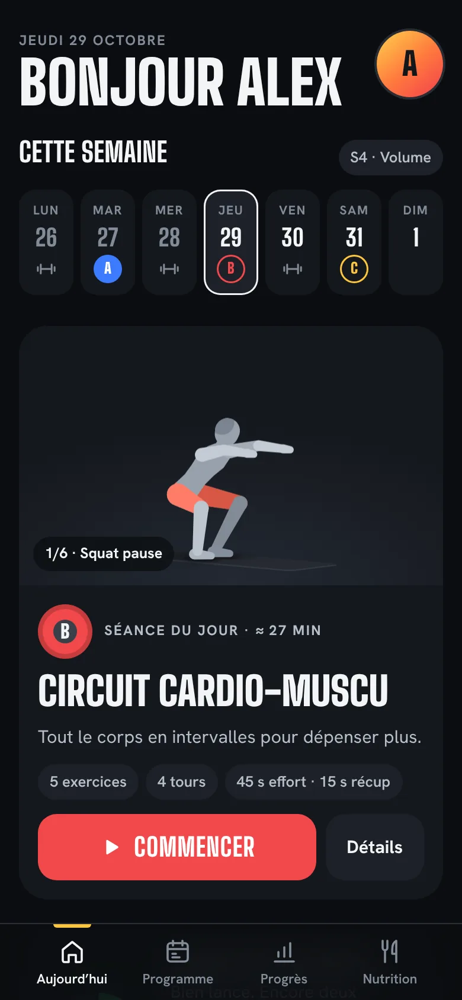
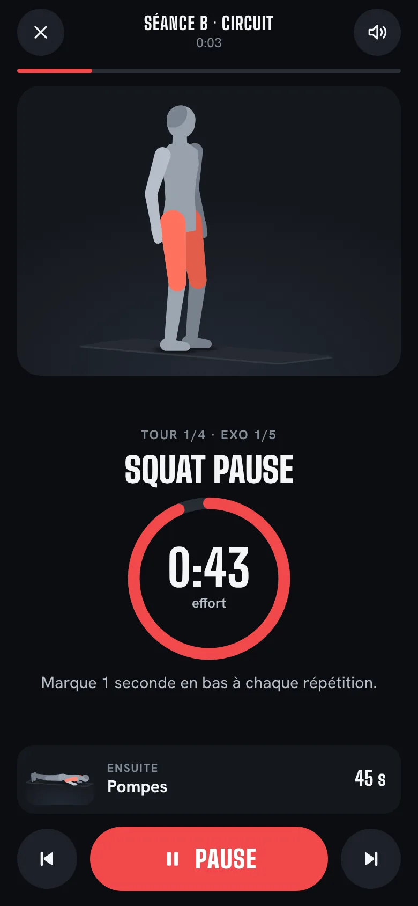
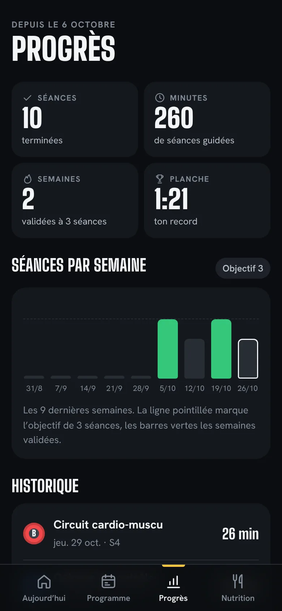

# Abdos Maison

Ton coach abdos à la maison : 3 séances guidées de 25 minutes par semaine pendant 9 semaines, 40 mouvements animés, cibles nutrition calculées d’après ton profil.

**[Ouvrir l’appli](https://zarock-73.github.io/abdos/app/)** (iPhone : Safari, puis « Sur l’écran d’accueil ») · **[Télécharger l’APK Android](https://zarock-73.github.io/abdos/abdos-maison.apk)** · **[Page de présentation](https://zarock-73.github.io/abdos/)**

  
  
  

- Gratuit, sans compte, sans pub, sans traceur. Les données restent sur le téléphone (stockage local).
- Fonctionne hors ligne une fois installée.
- Pour les adultes en bonne santé. Les cibles sont des estimations, pas un avis médical.

## Contenu du dépôt

| Chemin | Rôle |
|---|---|
| `index.html` | Page de présentation |
| `app/` | Web-app installable (une seule page, manifeste, service worker, icônes) |
| `abdos-maison.apk` | Application Android (paquet `ch.abdosmaison.open`) |
| `assets/` | Polices et captures de la présentation |

Version 1.3.1.
